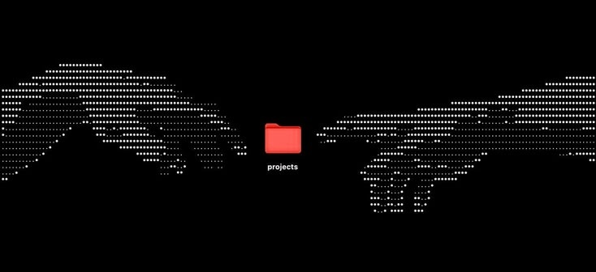

<!--
  Pra esse banner e a cobrinha funcionarem, no repositório kauancomper/kauancomper:
  1. Suba o arquivo banner-github.jpg na pasta /assets
  2. Suba o arquivo snake.yml em /.github/workflows
  3. Rode o workflow uma vez em Actions > Generate Snake > Run workflow
     (ele comita o SVG da cobrinha na branch "output", é isso que a seção GitHub mais abaixo usa)
-->

<h1 align="center">Oi, eu sou o Kauan 👋</h1>

---

### Sobre mim

Sou desenvolvedor full-stack focado em **Sistemas Web, Automação e IA Aplicada**.

Apaixonado por tecnologia desde a robótica (medalhista no FLL Regional Belém), gosto de construir soluções que automatizam processos, integram sistemas e aplicam IA generativa de forma prática — não como hype, como engenharia.

Atualmente focado em:

- Desenvolvimento Full-stack (`React`, `Next.js`, `Node.js`, `Python`)
- Automação de processos (`n8n`)
- IA Generativa aplicada (`Claude Code`, `Ollama`)
- Infraestrutura e deploy (`VPS`, `Docker`)
- Pesquisa em Sistemas de Informação na UNIFESSPA

---

### Stack

`React` `Next.js` `Node.js` `TypeScript` `Python` `PostgreSQL` `Docker` `Claude Code` `Ollama` `n8n` `VPS (Easypanel)` · experiência adicional em `Cisco Networking` e `Blender 3D`

---

### Projetos em destaque

<!--
  Substitua os links abaixo pelos repositórios que você quer mostrar.
  Sugestão de ordem: 1) o projeto mais ambicioso/atual (Compera), 2) o que tem resultado mensurável,
  3) o que mostra variedade de stack.
-->

<table>
<tr>
<td width="50%">

**Compera CRM**
Plataforma self-hosted de atendimento multicanal com agentes de IA — arquitetura, backend e painel de gestão.
`Node.js` `PostgreSQL` `IA`
[→ repositório](#)

</td>
<td width="50%">

**Simulador de Concursos**
App de estudos com banco de questões e métricas de desempenho, usado por candidatos reais de concurso público.
`React` `Next.js`
[→ repositório](#)

</td>
</tr>
<tr>
<td width="50%">

**Catálogo Continental (pneus)**
Plataforma de busca de pneus por medida/veículo integrada ao ERP de uma revenda, alimentada por scraping.
`Python` `Scraping` `Integração`
[→ repositório](#)

</td>
<td width="50%">

**kauan.dev**
Portfólio pessoal — identidade de marca própria, do zero.
`Next.js` `Design`
[→ projeto](https://kauancomper.vercel.app/)

</td>
</tr>
</table>

---

### GitHub

<picture>
<source media="(prefers-color-scheme: dark)" srcset="https://github.com/kauancomper/kauancomper/blob/output/github-contribution-grid-snake-dark.svg">

</picture>

---

### Conecte-se

